> *This project has been created as part of the 42 curriculum by okruhlia & kslimak *

# Pac-Man: Ghosts! More ghosts!

## 1. Description
For educational purposes, this project recreates the core mechanics of the classic 1980 arcade game Pac-Man while introducing our own unique artistic vision and visual style. Built entirely in Python (3.10+), the goal is to implement a complete, playable game using object-oriented programming (OOP) principles, a simple graphical library, and a modular architecture. The game features autonomous ghost AI, a dynamic level generation system, a persistent highscore tracker, and a polished graphical user interface (GUI).

## 2. Instructions

### Installation
To install the project dependencies (including the assigned `A-Maze-ing` package) in an isolated environment, run:
```
make install
```

### Execution
To start the game, you must provide a configuration file as an argument:
```
make run
```

### Development Commands
- `make debug`: Runs the game in debug mode (using `pdb`).
- `make lint`: Runs `flake8` and `mypy` to check coding standards and typing.
- `make clean`: Removes cache files (e.g., `__pycache__`, `.mypy_cache`).

## 3. Configuration
The game is configured via a JSON file (e.g., `config.json`). The parser has been extended to support comments starting with `#`. If any keys are missing, invalid, or faulty, the game will seamlessly clamp the values to safe defaults without crashing.

**Default Keys & Values:**
- `highscore_filename`: `"highscores.json"` (Path to save scores)
- `level`: `[{"width": 28, "height": 31}]` (Array defining level dimensions)
- `lives`: `3`
- `pacgum`: `42`
- `points_per_pacgum`: `10`
- `points_per_super_pacgum`: `50`
- `points_per_ghost`: `200`
- `seed`: `42` (Fixed seed for Level 1)
- `level_max_time`: `90` (Seconds per level)

## 4. Maze Generation
We utilize an external `A-Maze-ing` package (assigned by another group) to dynamically generate our levels. 
- The generator is called with `PERFECT = False` to ensure the maze has loops and connected corridors suitable for Pac-Man gameplay.
- Level 1 is always generated using a fixed seed (configured via `seed: 42`) for consistency.
- Subsequent levels generate random mazes. 
Our loader acts as an adapter, seamlessly converting the `A-Maze-ing` output into our internal grid system.

## 5. Highscore System
The persistent highscore system saves the top 10 players. 
- **Storage:** Data is stored locally in a lightweight JSON file (specified in the config). We chose JSON for its portability and human-readability.
- **Robustness:** If the file is missing or corrupted, the system safely initializes an empty scoreboard. 
- **Format:** Players can enter up to 10 alphanumeric characters for their name. Scores are non-negative integers. The highscore table is displayed on the main menu and updated upon winning or getting a Game Over.

## 6. Implementation
The game loop runs on a strict state-machine (Menu, Playing, Paused, Game Over). 
- **Graphics:** Built using `Pygame`.
- **Error Handling:** All exceptions (like missing assets or corrupted configs) are caught via `try-except` blocks. Context managers (`with`) are heavily used for file operations to prevent resource leaks.
- **Cheat Mode:** For peer review and evaluation purposes, a comprehensive cheat mode is implemented. The following keys can be pressed during gameplay to activate specific developer features:
  - `I`: **Invincibility** (The player loses no lives, and ghosts cannot eat the player).
  - `L`: **Level Skip** (Immediately wins the current level and progresses to the next).
  - `F`: **Ghost Freeze** (Stops all ghosts from moving).
  - `E`: **Extra Life** (Adds one additional life to the player's counter).
  - `S`: **Speed Boost** (Significantly increases the player's movement speed).

## 7. General Software Architecture
The architecture is strictly modular, dividing responsibilities between Entities, Managers, Graphics (GFX), and Utilities.

```mermaid
%%{init: {'theme': 'base', 'themeVariables': { 'clusterBkg': 'transparent', 'clusterBorder': '#555555', 'lineColor': '#00E5FF'}}}%%
classDiagram
    namespace Entities {
        class Player {
            +int lives
            +int score
            +float x
            +float y
            +move(direction)
            +lose_life()
        }
        
        class Ghost {
            +float x
            +float y
            +string color
            +bool is_edible
            +chase_player()
            +run_away()
        }
        
        class Consumable {
            +float x
            +float y
            +int point_value
            +string type
            +consume()
        }
    }
    style Player fill:#E3F2FD,stroke:#1565C0,stroke-width:2px,color:#000000
    style Ghost fill:#E3F2FD,stroke:#1565C0,stroke-width:2px,color:#000000
    style Consumable fill:#E3F2FD,stroke:#1565C0,stroke-width:2px,color:#000000
    
    namespace Managers {
        class Man_App {
            +string current_state
            +init()
            +run()
            +quit()
        }
        
        class Man_Physics {
            +check_collisions(entity1, entity2)
            +resolve_wall_collision(entity)
            +update_positions(delta_time)
        }
        
        class Man_Menu {
            +int selected_index
            +handle_input(key)
            +navigate_up()
            +navigate_down()
            +select_option()
        }
        
        class Man_Config {
            +dict settings
            +load_json(filepath)
            +save_json(filepath)
            -clamp_defaults()
        }
        
        class Man_Highscore {
            +int top_score
            +list recent_scores
            +load_scores()
            +save_new_score(score)
        }
    }
    style Man_App fill:#FFF3E0,stroke:#E65100,stroke-width:2px,color:#000000
    style Man_Physics fill:#FFF3E0,stroke:#E65100,stroke-width:2px,color:#000000
    style Man_Menu fill:#FFF3E0,stroke:#E65100,stroke-width:2px,color:#000000
    style Man_Config fill:#FFF3E0,stroke:#E65100,stroke-width:2px,color:#000000
    style Man_Highscore fill:#FFF3E0,stroke:#E65100,stroke-width:2px,color:#000000

    namespace GFX {
        class gfx_Screen {
            +int width
            +int height
            +clear()
            +render()
        }
        
        class gfx_Player {
            +draw(x, y, direction)
            +play_animation(state)
        }
        
        class gfx_Ghost {
            +draw(x, y, color, is_edible)
        }
        
        class gfx_Consumable {
            +draw_dot(x, y)
            +draw_power_pellet(x, y)
        }
        
        class gfx_Hud {
            +draw_score(score)
            +draw_lives(lives)
            +show_game_over()
        }
        
        class gfx_Menu {
            +draw_title()
            +draw_buttons(options, selected)
        }
        
        class Sprites {
            +dict texture_atlas
            +load_spritesheet(path)
            +get_sprite(id)
        }
        
        class Sounds {
            +float volume
            +play_waka()
            +play_eat_ghost()
            +play_death()
        }
    }
    style gfx_Screen fill:#E8F5E9,stroke:#2E7D32,stroke-width:2px,color:#000000
    style gfx_Player fill:#E8F5E9,stroke:#2E7D32,stroke-width:2px,color:#000000
    style gfx_Ghost fill:#E8F5E9,stroke:#2E7D32,stroke-width:2px,color:#000000
    style gfx_Consumable fill:#E8F5E9,stroke:#2E7D32,stroke-width:2px,color:#000000
    style gfx_Hud fill:#E8F5E9,stroke:#2E7D32,stroke-width:2px,color:#000000
    style gfx_Menu fill:#E8F5E9,stroke:#2E7D32,stroke-width:2px,color:#000000
    style Sprites fill:#E8F5E9,stroke:#2E7D32,stroke-width:2px,color:#000000
    style Sounds fill:#E8F5E9,stroke:#2E7D32,stroke-width:2px,color:#000000

    namespace Utils {
        class Maze_Adapter {
            +int[][] grid
            +load_level(level_id)
            +is_wall(x, y)
            +get_tile_type(x, y)
        }
        
        class Cheats {
            +bool god_mode
            +bool infinite_lives
            +toggle_cheat(cheat_code)
        }
        
        class Exits {
            +list portals
            +check_teleport(entity)
            +teleport_entity(entity, destination)
        }
    }
    style Maze_Adapter fill:#F3E5F5,stroke:#6A1B9A,stroke-width:2px,color:#000000
    style Cheats fill:#F3E5F5,stroke:#6A1B9A,stroke-width:2px,color:#000000
    style Exits fill:#F3E5F5,stroke:#6A1B9A,stroke-width:2px,color:#000000
    
    %% --- ВЗАИМОДЕЙСТВИЯ (СВЯЗИ) ---

    %% Главный контроллер управляет менеджерами и экраном
    Man_App --> Man_Physics
    Man_App --> Man_Menu
    Man_App --> Man_Config
    Man_App --> Man_Highscore
    Man_App --> gfx_Screen
    Man_App --> Sounds

    %% Физика обновляет сущности и проверяет карту
    Man_Physics --> Player
    Man_Physics --> Ghost
    Man_Physics --> Consumable
    Man_Physics ..> Maze_Adapter : check walls
    Man_Physics ..> Exits : check teleports

    %% Композиция экрана из отдельных элементов отрисовки
    gfx_Screen *-- gfx_Player
    gfx_Screen *-- gfx_Ghost
    gfx_Screen *-- gfx_Consumable
    gfx_Screen *-- gfx_Hud
    gfx_Screen *-- gfx_Menu

    %% Элементы отрисовки читают состояния сущностей
    gfx_Player ..> Player : reads state
    gfx_Ghost ..> Ghost : reads state
    gfx_Consumable ..> Consumable : reads state
    gfx_Hud ..> Player : reads score/lives

    %% Элементы отрисовки используют ресурсы (спрайты)
    gfx_Player ..> Sprites
    gfx_Ghost ..> Sprites
    gfx_Consumable ..> Sprites
    gfx_Hud ..> Sprites
    gfx_Menu ..> Sprites

    %% Читы влияют на игрока
    Cheats ..> Player : modifies
```



## 8. Project Management
We utilized an agile approach, heavily relying on GitHub's native tools to drive our workflow:
- **Issue Tracking & Kanban:** We used GitHub Projects to organize our backlog, track bugs, and manage feature implementation phases.
- **Version Control:** Strict branch management (feature branching, pull requests, and peer reviews) was enforced to maintain code quality and seamless collaboration.
- **Documentation:** Additional project management evidence—including the timeline, risk analysis, task delegation, and acceptance test plans—can be found in the `/project_management` directory at the root of this repository.

## 9. Resources
- **Python Typing Documentation:** https://docs.python.org/3/library/typing.html
- **PEP 257 (Docstrings):** https://peps.python.org/pep-0257/
- **Mermaid Documentation:** https://mermaid.js.org
- **Pygame Documentation:** https://www.pygame.org/docs/
- **AI Usage Disclaimer:** Artificial Intelligence was used during the development of this project strictly for educational support. AI assisted in:
  - Main structure discussion.
  - Visual signed discussion.
  - Refactoring suggestions.

  All AI-generated suggestions were hand-reviewed, refactored, and thoroughly analysed by the team before integration.